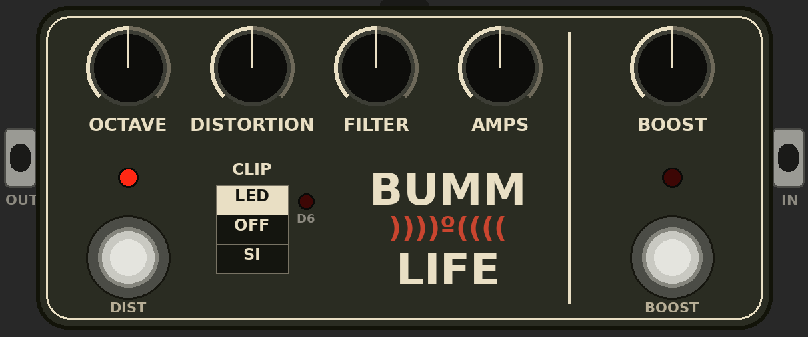

# The Doom Box — Max for Live

An Ableton Live audio effect built from the pedal schematic in [`docs/schematic.png`](docs/schematic.png) and the parts list in [`docs/parts-list.png`](docs/parts-list.png). Every stage is modelled from its real component values. The device doesn't add any controls the pedal doesn't have.



**Install:** drag `device/Doom Box.amxd` onto an audio track (needs Live Suite or Max for Live).

## Controls (same as the pedal)

| Control | Part | What it does in the circuit |
|---|---|---|
| OCTAVE | 50KB | Linear blend between the clean J201 signal (C3) and the rectified octave signal (C7) |
| DISTORTION | 100KA | LM308 feedback resistor: gain from ×1 up to ≈ ×2300 |
| FILTER | 100KA | (R_src + pot + R24 1k5) into C18 3n3: roughly 32 kHz down to about 470 Hz |
| AMPS | 100KA | Output volume of the DIST section |
| BOOST | 100KA | Output volume of the BS170 boost |
| CLIP (SW1) | SPDT on/off/on | **LED**: D4 + D6 (red LED) one way, D5 the other, so it clips asymmetrically. **OFF**: op-amp clipping only. **SI**: D7/D8 1N4148 pair |
| DIST footswitch | 3PDT | True bypass of the octave/distortion section; its LED lights when on |
| BOOST footswitch | 3PDT | True bypass of the boost; its LED lights when on |
| D6 | red 3 mm LED | Glows with the actual current flowing through D6 when CLIP is set to LED |

The pedal has only two jacks, so the chain is IN → DIST section → BOOST → OUT.

## What's modelled

- **Q1 / Q5, J201 buffers:** square-law JFET source followers with the gate at 0 V. They have limited negative headroom, just like the real circuit.
- **Octave:** the Q4 2N5089 stage (gain ≈ −R16/R17) feeds the Q3 2N5087 phase splitter. Both have asymmetric saturation limits worked out from the bias network. C9/C8 couple into a D3/D2 diode-OR full-wave rectifier, followed by the Q2 follower.
- **LM308:** the exact non-inverting transfer function (560Ω + 4µ7 and 47Ω + 2µ2 legs, 100p across the pot). It also includes finite gain-bandwidth from the 30p compensation, so high-gain settings get darker like the real chip, plus the 0.3 V/µs slew rate and 9 V rail clipping.
- **Diode network:** solved per sample with Newton iteration through R23 1k, using 1N4148 and red-LED diode parameters. The filter sees the clipper's real source impedance.
- **BS170 boost:** level-1 MOSFET model with R29 drain-to-gate feedback bias, solved for the gate node. The operating point is Vd ≈ 4.8 V and gain is ≈ 25 dB. AMPS loads the boost input like the real pot would.
- All the coupling caps and their real corners are included (C2, C3, C10, C9/C8, C7, C5, C19, C20, C22, C23).
- **8× oversampling** with 10th-order elliptic up/down filters.

## Notes

- **Mono, like the pedal:** L+R is summed in and the same signal goes out both sides. This also keeps the CPU cost reasonable at 8× oversampling.
- **Levels:** 1.0 digital = 1 V. A DI guitar peaking around −10 dBFS behaves like a real pickup. The BOOST is as loud as the real one, so it can push past 0 dBFS when it's turned up.
- **Assumed part values (not on the schematic):** J201 Idss 0.6 mA / Vp −0.8 V; BS170 Vth 2.1 V, K 0.05 A/V².
- **D2/D3 orientation:** in the drawing they're hard to read, so I've assumed they point into Q2's base. That's the only way the stage can bias and work as a full-wave octave.

The gen~ code puts functions first, then Params/Histories, then statements (a GenExpr rule). It uses plain decimal literals only and writes every History at top level, never inside an `if` or a loop.

Max stores patcher boxes front-to-back (first = drawn on top), so the builder writes them in reverse of the order it creates them.

## Rebuilding

```
cd tools
python3 gencode.py && mv dsp.genexpr ../src/doom_box.genexpr
python3 build_amxd.py "../device/Doom Box.amxd" ../src/doom_box.genexpr
python3 test.py                                     # offline tests: runs the gen code through harness.js in Node
```
